  

  

### 🧩 What I work on

- 🧠 **AI & Machine Learning** — building and training models with PyTorch, and fine-tuning LLMs with LoRA
- 🔌 **IoT & Embedded** — sensors, microcontrollers, and an exploration robot that streams live data to the cloud
- ⚙️ **And to tie it together** — .NET APIs and React dashboards

### 🛠️ Toolbox

  

  

☕ → 🧑‍💻 → 🧱 · debugging after midnight 🌙

